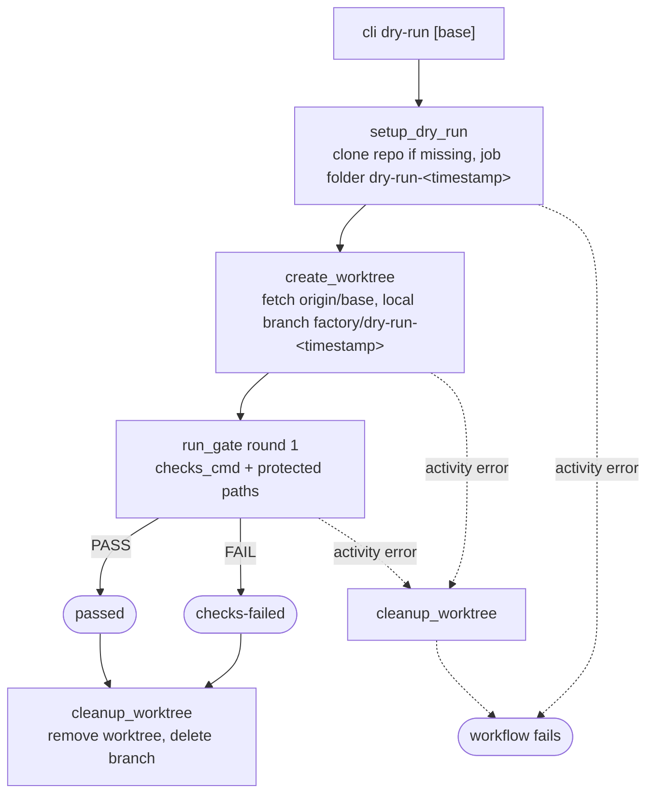

# CI dry run flow

`CiDryRunWorkflow` (`factory/flows/ci_dry_run.py`, id `factory-ci-dry-run-<UTC YYYYMMDD-HHMMSS>`): checks that the base branch passes the factory's checks right now, without an issue, agents or a PR. Use it to verify the target repo and `checks_cmd` before queueing work, or to tell whether a red gate comes from main itself.

- The branch is never pushed; `cleanup_worktree` removes the worktree and deletes the local branch on every outcome, including errors from `create_worktree` or `run_gate` (not `setup_dry_run`). If cleanup itself fails there, it is logged and the original error is still the failure cause.
- `Job.issue` is `0` (no issue). Base defaults to `base_branch` in `config.json`.
- Result: the workflow returns the stage; `round-1/checks.md` and `checks.log` stay in the job folder (`status` query `job_dir`). The CLI waits (Ctrl-C leaves the workflow running), prints the stage and report path, and exits 1 unless the stage is `passed`; `dry-run --json` prints `{"workflow_id", "stage", "job_dir", "report"}` on stdout instead (progress on stderr), which `scripts/dry-run.sh` parses inside the worker container to print the report.
- Not started by the queue (no `label` in `flows.ci-dry-run`).

## Job folder artifacts

| File | Written by |
|---|---|
| `round-1/checks.md`, `round-1/checks.log` | `run_gate` |

## Later
- Run it on a Temporal Schedule (e.g. nightly) and report a failure on GitHub.
- Cancelling the workflow mid-gate skips cleanup (cleanup runs on activity errors only).
