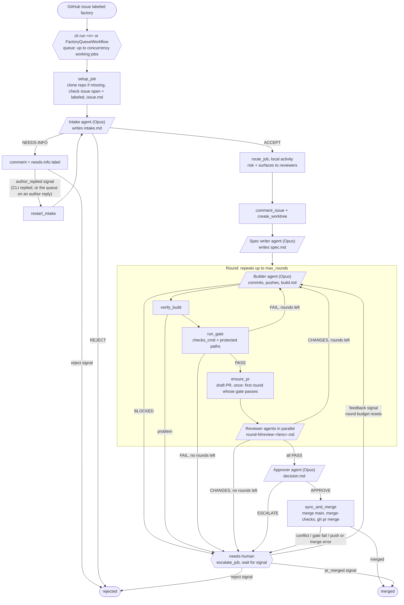
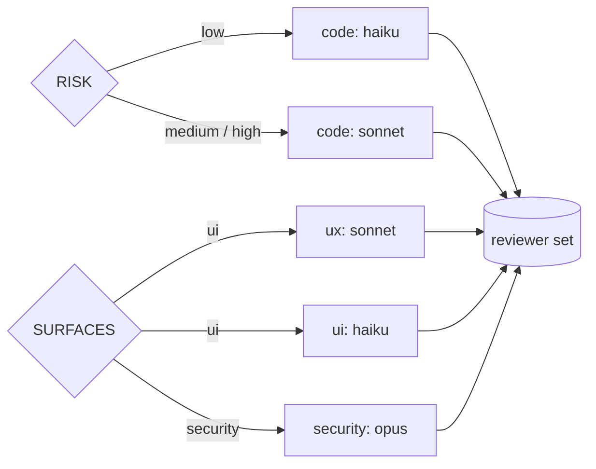

# Implement flow

`ImplementWorkflow` (`factory/flows/implement.py`, Temporal type `JobWorkflow`, id `factory-job-<issue>`): one GitHub issue becomes a merged PR. Issues labeled `factory` run it (config `flows.implement.label`). It only composes shared steps from `factory/flows/steps/` (see [[Pipeline flow#Shared steps]]).

## Stages

Parallelograms are Claude agents (Claude Agent SDK, prompts in `factory/prompts/`). Rectangles are deterministic activities.

- **Trigger:** `FactoryQueueWorkflow` (`factory/flows/queue.py`) starts a job per labeled issue while fewer than `concurrency` jobs are working (`config.json`, default 3; waiting jobs don't count), and never while it tracks an open job for the issue under any flow. It also signals `author_replied` to needs-info jobs whose author (or the operator) replied, while under the cap.
- **Cleanup:** every terminal stage reached after the worktree exists (merged via `sync_and_merge` or `pr_merged`, rejected from needs-human) runs `cleanup_worktree` through `FactoryWorkflow.finish`. The intake REJECT path returns before the worktree exists and runs no cleanup; a needs-info reject also happens before the worktree exists (its `finish` cleanup is a no-op apart from `git branch -D`).
- **Intake REJECT** comments and removes the flow's trigger label (`flows.implement.label`, resolved by `edit_labels` from `LabelChange.remove_flow_label`, a `FlowName`; nothing is removed if the flow has no entry or label), not `labels.queue`.
- `route_job` runs as a local activity and raises if intake's risk or a surface isn't in `config.json` (raised in `route()`, `factory/core/routing.py`).
- The workflow fails (and reports `failed` to the queue) when an activity raises after its retries, e.g. `setup_job` on a closed or unlabeled issue or malformed agent output.

## Reviewer routing

`route_job` (`factory/activities/routing.py`, calling `route()` in `factory/core/routing.py`) builds the reviewer set from intake's `RISK` and `SURFACES` using `factory/config.json`.

## Job folder artifacts

| File | Written by |
|---|---|
| `issue.md` | `setup_job` / `restart_intake` |
| `intake.md` | intake agent |
| `spec.md` | spec writer |
| `build.md` | builder |
| `round-N/checks.md`, `checks.log` | `run_gate` |
| `round-N/review-<lens>.md` | reviewers |
| `decision.md` | approver; `escalate_job` on every other escalation (a failed merge overwrites the approver's `APPROVE`) |
| `round-N/merge-checks.md`, `merge-checks.log` | `sync_and_merge` (re-runs the gate) |
| `feedback-K.md` | `write_feedback` |
| `rejection.md` | `reject_job` |
| `intake-K.md` | `restart_intake` (archives the previous `intake.md`) |
