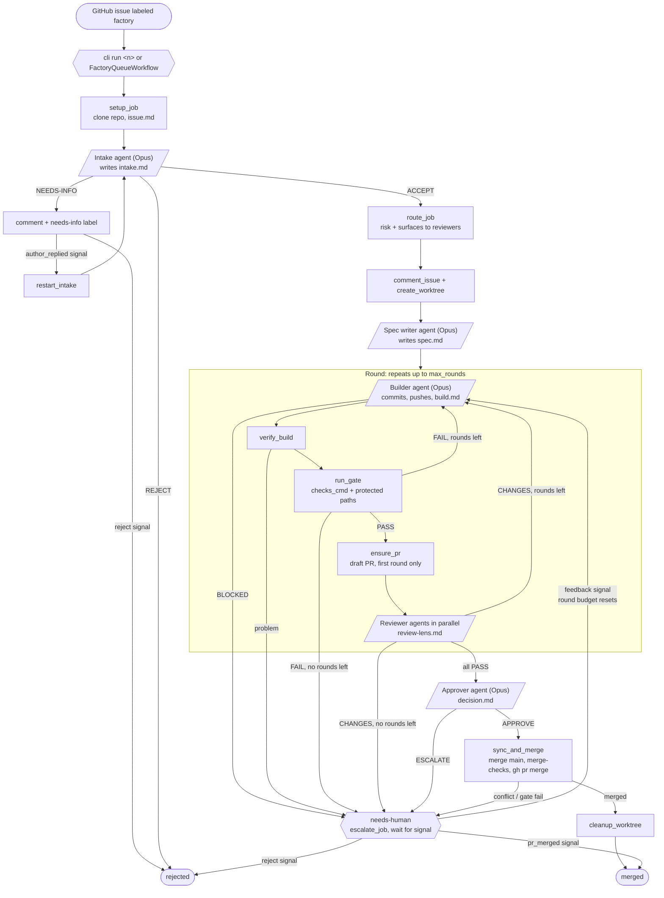
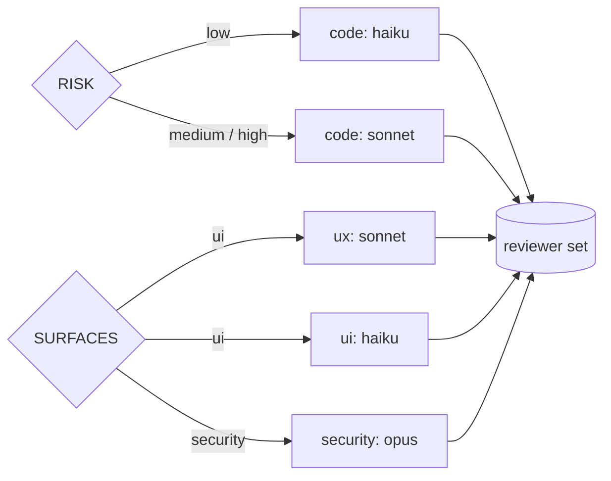
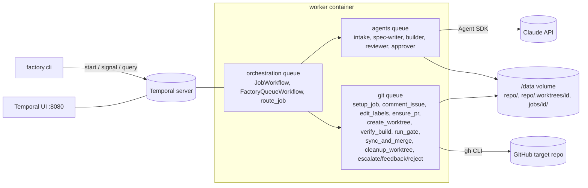

# Pipeline flow

The current `JobWorkflow` pipeline (`factory/workflows/job.py`): one GitHub issue becomes a merged PR.

## Stages

Parallelograms are Claude agents (Claude Agent SDK, prompts in `factory/prompts/`). Rectangles are deterministic activities.

## Reviewer routing

`route_job` (`factory/routing.py`) builds the reviewer set from intake's `RISK` and `SURFACES` using `factory/config.json`.

## Components and task queues

## Job folder artifacts

| File | Written by |
|---|---|
| `issue.md` | `setup_job` / `restart_intake` |
| `intake.md` | intake agent |
| `spec.md` | spec writer |
| `build.md` | builder |
| `round-N/checks.md`, `checks.log` | `run_gate` |
| `round-N/review-<lens>.md` | reviewers |
| `decision.md` | approver (or `escalate_job`) |
| `round-N/merge-checks.md` | `sync_and_merge` |
| `feedback-K.md` | `write_feedback` |
