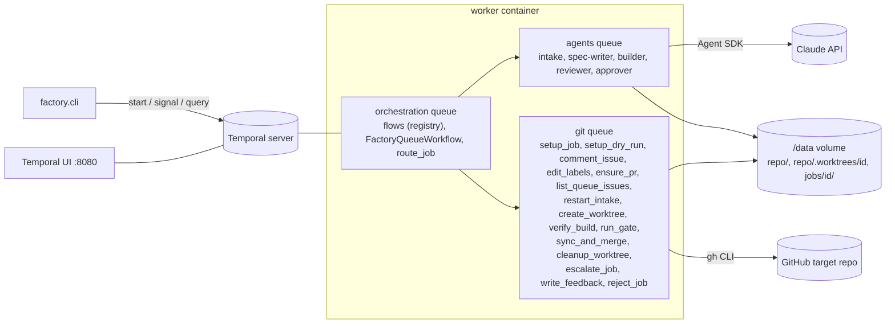

# Pipeline flow

The factory runs several **flows** (Temporal workflows) built from shared **steps**. One note per flow in `Flows/`:

| Flow | Workflow (id) | Started by | Note |
|---|---|---|---|
| `implement` | `ImplementWorkflow`, type `JobWorkflow` (`factory-job-<issue>`) | issue label `factory`, or `cli run <issue>` | [[Implement]] |
| `ci-dry-run` | `CiDryRunWorkflow` (`factory-ci-dry-run-<UTC YYYYMMDD-HHMMSS>`) | `cli dry-run [base]` | [[CI dry run]] |

## Dispatch

`FactoryQueueWorkflow` (`factory/flows/queue.py`) polls `list_queue_issues`, which lists open issues carrying any flow's `label` (`config.json` `flows`) and picks each issue's flow: the first entry in `flows` whose label the issue has. The queue starts that flow as a child workflow (`factory/flows/registry.py`: class and workflow id) while fewer than `concurrency` flows are working; waiting flows (`needs-info`, `needs-human`) don't count. The queue tracks at most one open job per issue across flows: if its labels now resolve to another flow while a tracked job is working or waiting, the queue logs a warning and starts nothing (author replies still go to the open job). Jobs started with `cli run` aren't tracked ([[One job per issue guard]]). To switch flows, let the first job end (merged, rejected or failed), then relabel. A failed poll (`list_queue_issues` raises after its retries, e.g. on an invalid `config.json`) is logged and nothing is dispatched until the next poll; issues whose flow the queue can't start are skipped with a warning. Flows started by the queue report back with the `job_state` signal (`FactoryWorkflow.notify`) when they start waiting, resume after human feedback, or end, keyed by workflow id (after an author reply the queue marks the job `resuming` itself); flows started from the CLI have no parent and don't report. The issue commands (`run`, `status`, `merged`, `replied`, `feedback`, `reject`) take `--flow <name>` to target an issue-driven flow by hand (default `implement`).

## Shared steps

`factory/flows/base.py` `FactoryWorkflow` holds the state every flow shares (stage, round, waits, PR, cost, builder session), the `status` query, the signals (`author_replied`, `human_feedback`, `reject`, `pr_merged`), `notify` (report to the queue), `reporting` (report the terminal stage or FAILED) and `finish` (cleanup_worktree + terminal stage).

| Step | Module | Does |
|---|---|---|
| `intake`, `wait_for_author`, `reject_at_intake` | `steps/intake.py` | intake agent; NEEDS-INFO: comment, label, wait for the author (then `restart_intake`) or a reject; REJECT: comment, remove the flow's label |
| `prepare` | `steps/prepare.py` | route reviewers, intake comment, worktree, spec writer |
| `build_round`, `build_rounds` | `steps/build.py` | build → verify → gate → PR → reviews; rounds until reviewed, then ship; escalates when the builder is blocked, the build can't be gated, rounds run out or the merge fails |
| `approve_and_merge` | `steps/ship.py` | approver, then `sync_and_merge` |
| `wait_for_human` | `steps/human.py` | escalate, wait for feedback / reject / merged |

## Components and task queues

